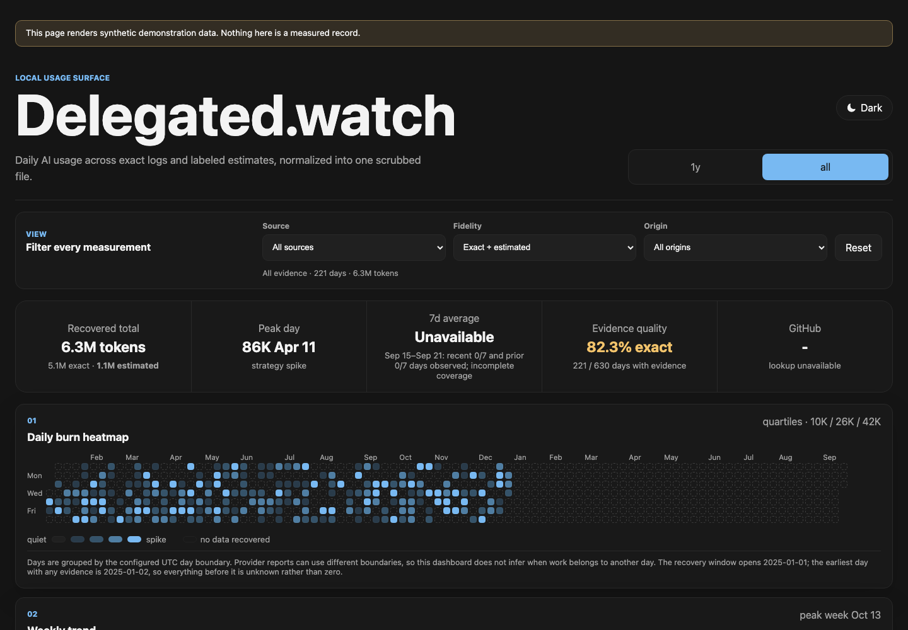

# Delegated.watch
A local-first record of the work you delegate to AI models, counted in tokens, that refuses to lower a committed number without a stated reason and is honest about what it cannot see.
Tokens here are the units a language model consumes reading and writing text. Not cryptocurrency: there is no blockchain, no supply, no burning in that sense, and no token count is ever converted into money. Not to be confused with delegated.to, a different company.

The site is at [delegated.watch](https://delegated.watch/); the dashboard above runs at [delegated.watch/demo/](https://delegated.watch/demo/) over synthetic demonstration data.
## A worked receipt, synthetic
Every identity, date, and count in this section is invented. Nothing here is anyone's measured usage.
A receipt is one source's counters for one day, written by an extractor or a capture tool after scrubbing. This one is the first of four in `fixtures/receipts/day-one.jsonl`, the fixture the demo imports. It is shown as data to read, not as a receipt to import into a record of your own.
Literal
```json
{
  "schema_version": 2,
  "date": "2025-01-04",
  "timezone": "UTC",
  "source": "codex",
  "provider": "openai",
  "surface": "cli",
  "account_alias": "example",
  "origin": "machine/example",
  "snapshot_key": "synthetic:codex:2025-01-04:machine/example",
  "authority": "tool",
  "interval": { "start": "2025-01-04", "end": "2025-01-04" },
  "tokens": 4200,
  "calls": 6,
  "fidelity": "exact",
  "provenance": "synthetic: local tool counter, day one"
}
```
`fidelity: "exact"` classifies the fixture's counter the way a real tool counter would be classified. It does not make these provider-verified numbers.
The same fixture holds a second receipt for that day: a `claude_chat` estimate of 1,800 tokens with no call count. The importer merges both into one daily row. This is the row it writes, captured from the importer itself run over the fixture:
Literal
```json
{
  "date": "2025-01-04",
  "timezone": "UTC",
  "sources": {
    "codex": {
      "tokens": 4200,
      "fidelity": "exact",
      "calls": 6,
      "authority": "tool",
      "by_origin": { "machine/example": 4200 }
    },
    "claude_chat": {
      "tokens": 1800,
      "fidelity": "estimated",
      "authority": "estimated",
      "by_origin": { "account/example-provider": 1800 }
    }
  },
  "total": 6000,
  "driver": "unreviewed",
  "evidence": "imported from local receipts; pending review"
}
```
| Synthetic receipt | What the row records |
|---|---|
| `codex`: 4,200 tokens, 6 calls, exact, from the tool's own counter | `sources.codex`: 4,200 tokens, 6 calls, fidelity `exact`, authority `tool`, attributed to `machine/example` |
| `claude_chat`: 1,800 tokens, no call count, estimated | `sources.claude_chat`: 1,800 tokens, fidelity `estimated`, authority `estimated`, and no `calls` field at all |
| Both, for 2025-01-04 | `total` 6,000, and driver `unreviewed` until someone reviews what the work was |
Each source keeps its own fidelity and records where its counter came from. An exact entry and an estimated one sit side by side, and the total is not an exact measurement because one of its parts is. A count the source never reported stays absent; it is never written as zero. Importing a row does not review it, and a token count says how much the model read and wrote, not how good or how valuable the work was.
This example is synthetic. A real record covers only the supported sources, and only the intervals for which evidence survives.
## Try it on the synthetic fixtures
Install Node 24 (the pinned LTS line) or the verified-compatible Node 26 line. There are no runtime dependencies, so there is no install step. Clone into a fresh directory, separate from any checkout that holds a record of your own. Cloning contacts GitHub; nothing after it reads a provider, an account, or the network.
Literal
```bash
git clone https://github.com/snapsynapse/delegated-watch.git && cd delegated-watch
```
Confirm the running Node version is supported.
Literal
```bash
npm run check:runtime
```
Walk the importer's gates. This runs the real importer against throwaway copies of the synthetic dataset and the fixture receipts, deletes the copies when it finishes, and leaves this checkout's own files untouched.
Literal
```bash
npm run demo:import
```
It prints one line per scenario:
| Synthetic scenario | What the line reports |
|---|---|
| `day-one.jsonl` | Two new rows, 2025-01-04 and 2025-01-05, both with driver `unreviewed` |
| `regression.jsonl` | Refused: an exact claim of 10,000 tokens for 2025-01-02 `codex` would lower the committed 36,327, and the dataset is left as it was |
| `estimated.jsonl` | An estimated `claude_chat` entry joins 2025-01-09 beside two exact sources, and each keeps its own fidelity |
| A receipt dated today, generated at run time | Held back until its Sunday-to-Saturday week is complete in the timezone set in `config/profile.json` |
A scenario that does not behave as expected says so on its line, and the command then exits 1 with a count of how many did not. Exit 0 means all four outcomes occurred. This demonstrates the importer's behavior on fixtures, not any provider's accuracy or any record's completeness.
## See the dashboard
Literal
```bash
npm run dev
```
It prints a loopback address. Open it, and its `/demo/` route for the dashboard, then press Control-C in the terminal to stop. It serves the shipped synthetic dataset, not the rows `demo:import` added, which were deleted with their temporary copies. Nothing is published.
## Installing this with an agent
Point the assistant at the [served assistant guide](https://delegated.watch/.well-known/assistant-guide.txt) and have it report the verifier, guide hash, achieved level, and blocking findings before it runs anything. The guide uses the [GuideCheck](https://guidecheck.org/) Human-Verifiable Assistant Guide profile 2.0.0. Its structured actions carry explicit approval gates. The hosted verifier checks through Level 3. The sidecar manifest and DNS TXT record at `_assistant-guide.delegated.watch` publish the guide's SHA-256 for independent provenance verification.
The repository-root [review copy](assistant-guide.txt) has the same bytes as `docs/.well-known/assistant-guide.txt`. Every CI job checks the two copies, the byte profile, the approval gates, the `exec-sha256` pins, and the manifest against the guide's actual bytes.
## Three invariants
- Unknown is never zero. A day with no recovered evidence is absent from the dataset entirely, not written in as a zero. A zero-token row is valid only when the source reports positive call activity or measured token components, and the dashboard renders that evidence differently from an absent day.
- The day is not counted until it has ended. A row describes a whole calendar day in the configured timezone. By default the importer holds back the whole Sunday-to-Saturday week in progress and imports it once that week has fully elapsed, so the record ends on the last complete Saturday; `import_weeks: "daily"` in `config/profile.json` holds back only the day in progress.
- A blocked regression is evidence loss, not a correction. The importer refuses to lower an already-committed exact value, because a number that falls usually means the source log disappeared rather than that the original count was wrong; lowering it on purpose requires an explicit flag, a confirmation, and a written reason.
## What this is
A chain of receipts, one deterministic importer, one JSON dataset, and one static page that renders it. An extractor or capture tool reads a provider's own counters and writes a scrubbed receipt carrying a token count, a call count, and a provenance note. The importer merges receipts into a single local-first record, applying gates that keep the record honest as it grows. Nothing here calls out to a server at read time.
## What this is not
- No cost modeling and no price table, by construction, not as a display flag you can turn back on; there is no unit conversion from tokens to a currency anywhere in the schema or the code. Where a provider computes its own charge (Perplexity per call, the Anthropic and OpenAI organization cost reports per day), the local receipt keeps that figure verbatim as provenance; it never enters the dataset or the page.
- No budgets or alerts. Nothing here watches a number and tells you to stop.
- No leaderboard or scoreboard. A day's total is not ranked against anyone else's.
- No backend. The dashboard is a static page built from one JSON file.
- No cloud sync. Receipts and the dataset live on disk and are never uploaded by the tool. Hosted captures send the inference request only to the endpoint the operator selects, and usage extractors make explicitly authorized read-only requests to provider reporting APIs.
- No prompt text ever enters the record. Extractors and captures read only counters, identifiers, and timestamps; the schema has no field for prompt or response content.
## What it cannot see
The full surface register, every source id with the recovery state it can reach and the basis for that classification, is in [SURFACES.md](SURFACES.md). It distinguishes four states rather than two: exact, estimated, dates only, and unrecoverable. The classes below are the structural ones, where no extractor can change the answer.
- Provider-side web search and research steps. These run inside the provider's own infrastructure mid-response, and the client never receives a token count for them, only a per-call marker.
- Consumer chat surfaces that expose no counter. Some hosted chat interfaces return only rendered text, with no usage figure available at any layer a client can read.
- Image and video services without a usage ledger. A service billed per generated asset rather than per token has no token counter to capture in the first place.
- Local inference that is not routed through a capture. A model run directly, through an app, or through a third-party client never passes through a wrapper that reads its counters, so the call leaves no trace here.
- Deleted or rotated logs. Once a transcript or session log is removed by a retention policy or a reinstall, the counters it held cannot be recovered from anywhere else.
## How data flows
Receipt JSONL, written by an extractor or a capture tool, is merged by `npm run import` under the gates described in `DATA_CONTRACT.md`. The result is `public/data/daily-burn.json`, the one dataset file. `npm run build` bakes it into `docs/demo/index.html`, a self-contained page that renders straight from disk, and renders the home page at `docs/index.html` from `src/landing.html`, with `docs/sitemap.xml` beside it. Neither served page is hand-edited, and every public URL either one names comes from `config/site.json`.
The dataset shipped with this candidate is synthetic demonstration data, not anyone's real usage. Regenerate it with `npm run demo:data`, and walk the same importer gates a real receipt would face with `npm run demo:import`.
## Running it on your own record
The goal is that you install this, point it at your own machine and accounts, and see all of your own delegated work: every surface, every provider, as far back as the evidence survives. [SURFACES.md](SURFACES.md#supported-services) keeps the one list of every surface: what ships, how each was verified, what is planned, and what cannot be counted.
One command finds every surface this machine has, imports it, and builds your dashboard:
Literal
```bash
npm run refresh
```
The first run switches this checkout to a record of your own: it creates `config/record.json` and a `record/` directory, both git-ignored, so a clone holding your record cannot publish it by being committed. From then on every command works on your record instead of the shipped synthetic demo; delete `config/record.json` to go back. Your dashboard is `record/index.html`; open it directly, or run `npm run dev` and visit the address it prints. Run `npm run refresh` again whenever you want it current. `npm run validate` still checks the shipped demo dataset; the import validates your record every time it writes it.
Each extractor reports every store it looks for as read, not found, or unreadable. A store that is not there writes nothing. One that cannot be read, or whose records cannot be counted without a decision from you, is reported as unknown and leaves its previous receipts alone; the rest of the run carries on and the summary says which.
The [guides](guides/README.md) take it from there, one per kind of source:
- [Local agent transcripts](guides/local-agent-transcripts.md): Claude Code, Codex, goose, the VS Code agent extensions, Cursor, Zed, Gemini CLI, and Copilot CLI, and the decisions some of them need from you.
- [Local and OpenAI-compatible captures](guides/local-and-openai-compatible-captures.md): Ollama, LM Studio, llama.cpp, vLLM, MLX, and hosted APIs that speak the chat completions shape.
- [Organization usage reports](guides/organization-usage-reports.md): the Anthropic and OpenAI admin reports, reconciling them with local extractors, and what an unreachable preflight means.
- [Consumer chat exports](guides/consumer-chat-exports.md): claude.ai and ChatGPT usage, estimated from account exports.
- [Perplexity and TypeSafe capture](guides/perplexity-and-typesafe-capture.md): the Claude Code hook and the scripted relays.
- [Reading your record](guides/reading-your-record.md): the decisions the dashboard informs, shown on the synthetic dataset.
- [Commands](guides/commands.md): every `npm run` script, one line each.
For any other source, write receipts to the contract in `DATA_CONTRACT.md` and run `npm run import` against them. Writing an extractor for a service that is not yet supported is covered in `CONTRIBUTING.md`.
## Roadmap
What is planned, in priority order, and what has been decided against permanently, is in [ROADMAP.md](ROADMAP.md).
## Status
0.6.1. Receipts without a request identity can gain a token breakdown when token and call counters match. Credential preflight and the usage extractors recognize additional provider-unreachable errors. This release includes the assistant-guide review copy. The importer holds back the week in progress by default, and personal records stay local unless their owner elects to publish them.
## Contributing
Ground rules, commit conventions, and what a change to a design invariant requires are in [CONTRIBUTING.md](CONTRIBUTING.md). Report a vulnerability privately as described in [SECURITY.md](SECURITY.md), not in a public issue.
## Attribution
Origin, lineage, and license attribution are recorded in `ATTRIBUTION.md`.
## License
MIT. Copyright Snap Synapse LLC. See [LICENSE](LICENSE).
